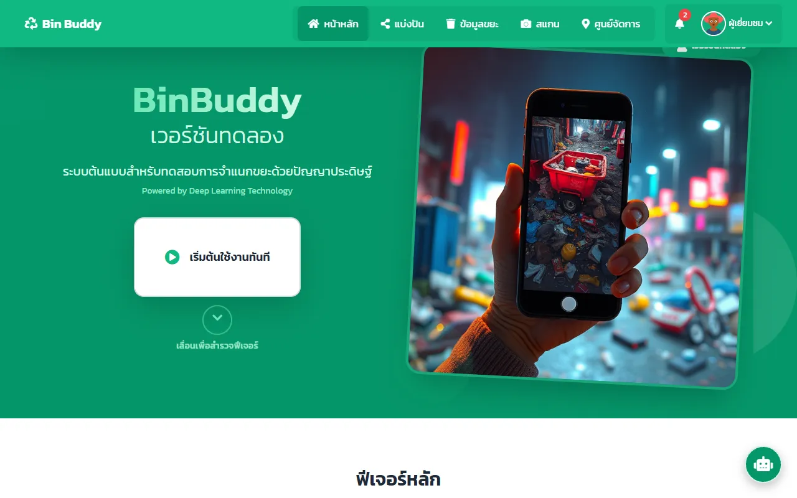
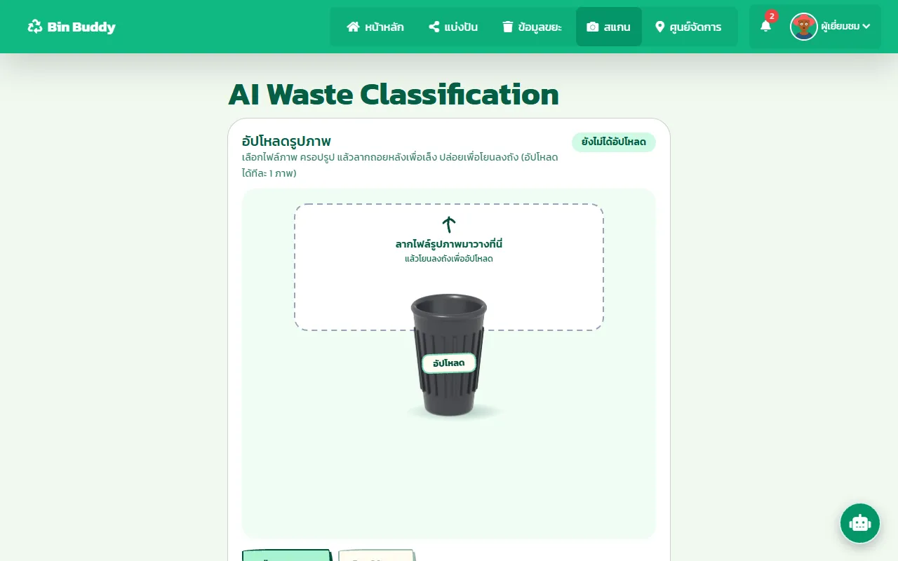
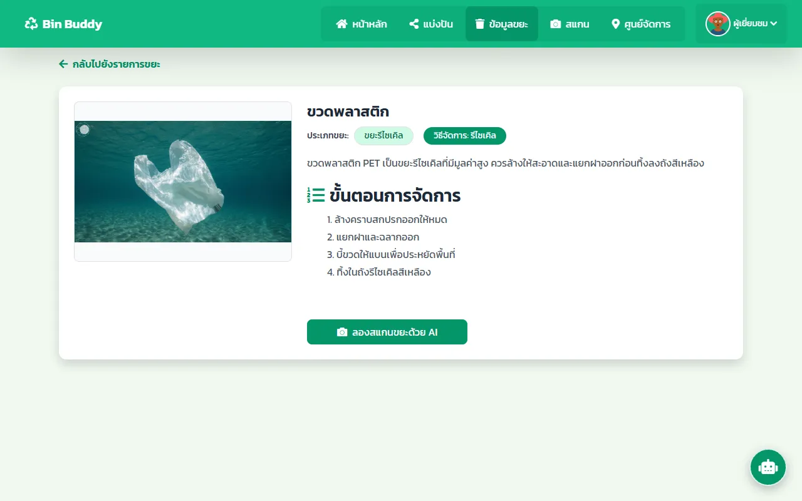
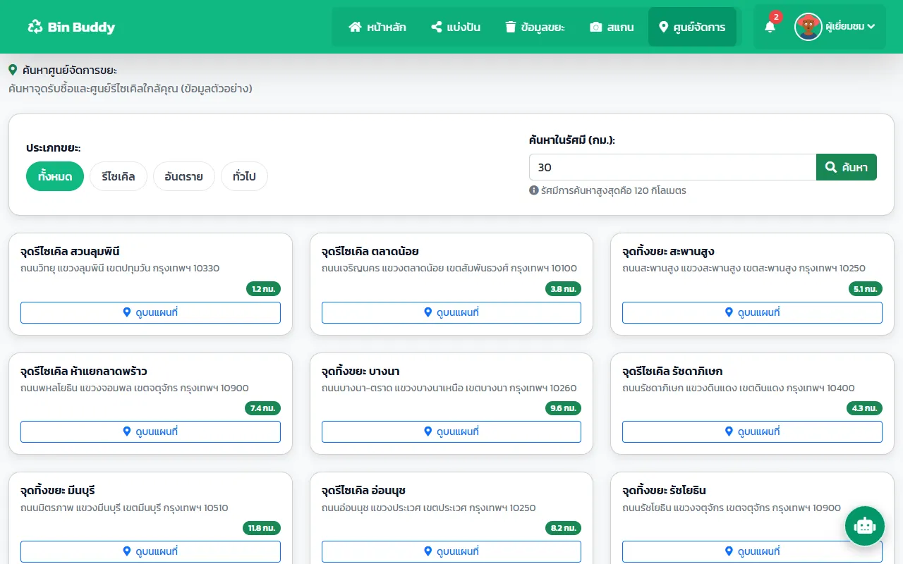

# BinBuddy — AI waste classification

A web app that tells you what kind of waste you are holding. You upload a photo, an image model predicts the type, and the app shows how to handle it and where the nearest waste center is. Admins can train new model versions from the back office and get a LINE message when training finishes.

Senior project, B.Sc. Computer Science and Information Technology, Chiang Rai Rajabhat University (2025).

| Home | Scan with AI |
|---|---|
|  |  |
| **How to handle each type** | **Nearby waste centers** |
|  |  |

## Features

- **Scan:** upload one photo and get the waste type with its top predictions. If the model is unsure, the app says so instead of guessing.
- **Handling guide:** reuse, recycle and dispose steps for each waste type.
- **Waste centers:** find centers within a chosen radius and get directions on a map.
- **Community:** posts, comments, likes and notifications.
- **Back office:** manage users, posts, reports and waste content.
- **Model training:** train a new version, compare versions, and pick the one in use. Version 4 reached 74.72% accuracy. When training finishes, n8n sends a LINE notification.

## How it works

```
Browser ──> PHP pages (XAMPP, MySQL) ──> FastAPI model server (PyTorch + timm ConvNeXt)
                                    └──> Gemini API (fallback image analysis)
Admin "train" ──> FastAPI /train ──> train.py ──> models/<version>/best.pt ──> n8n ──> LINE
```

| Folder | What it holds |
|---|---|
| `/` (root) | PHP pages and endpoints: login, scan, posts, locations and so on |
| `admin/` | Back office (HTML + PHP API in `admin/api/`) |
| `API/` | Gemini proxy and the analysis router |
| `backend/` | FastAPI server (`main.py`), training script (`train.py`) and dataset tools |
| `models/` | Model metadata per version (labels, status). Weights are **not** in git |
| `database/` | `schema.sql` (tables) and `seed.sql` (waste types and sample centers) |
| `css/`, `img/` | Styles and UI images. User uploads are git-ignored |

## Run it locally

1. **Web**
   - Copy the folder to `C:\xampp\htdocs\binbuddy` and start Apache and MySQL in XAMPP.
   - In phpMyAdmin, create the database `waste_system` (utf8mb4). Import `database/schema.sql`, then `database/seed.sql`.
   - Copy `.env.example` to `.env` and fill it in.
   - Run `composer install`, which installs PHPMailer for the "forgot password" email.
   - Open `http://localhost/binbuddy/`.
2. **Model server**
   ```bash
   cd backend
   python -m venv .venv && .venv\Scripts\activate
   pip install -r requirements.txt
   copy .env.example .env
   uvicorn main:app --host 127.0.0.1 --port 8000
   ```
   Put a trained checkpoint at `models/<version>/best.pt`. Weights are too large for git.

## Security notes

- Secrets live only in `.env` and `backend/.env`, and neither file is committed. That covers database settings, the SMTP app password, API keys and the admin account.
- Passwords are stored with `password_hash`. Accounts created before hashing was added are upgraded automatically on their next login.
- User uploads (profile pictures, post images) and the database dump are never committed.

## Tech

PHP 8 · MySQL · JavaScript · Python · FastAPI · PyTorch / timm · OpenStreetMap / Google Places · Google Gemini · n8n · LINE Messaging
